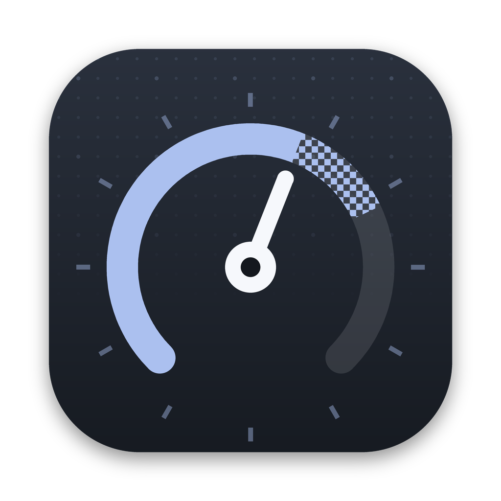
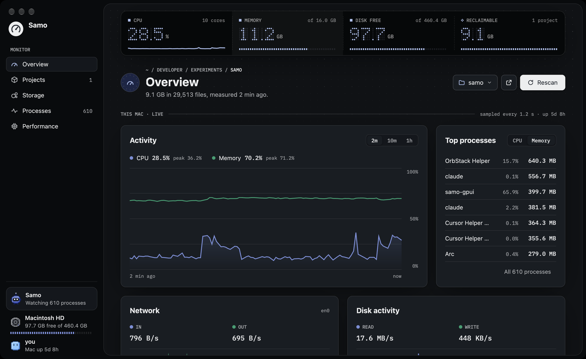
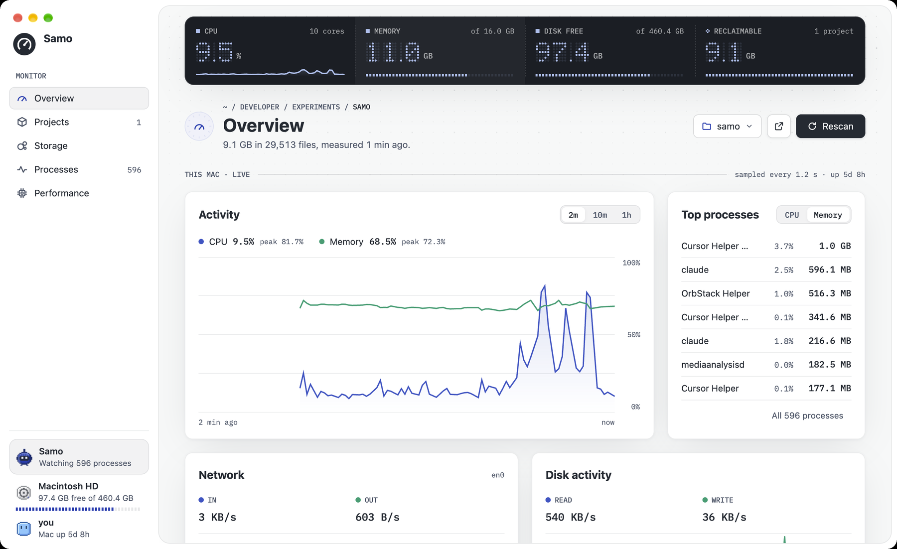
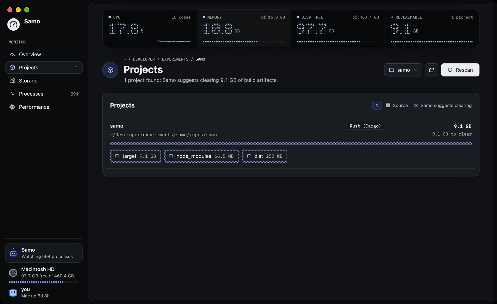
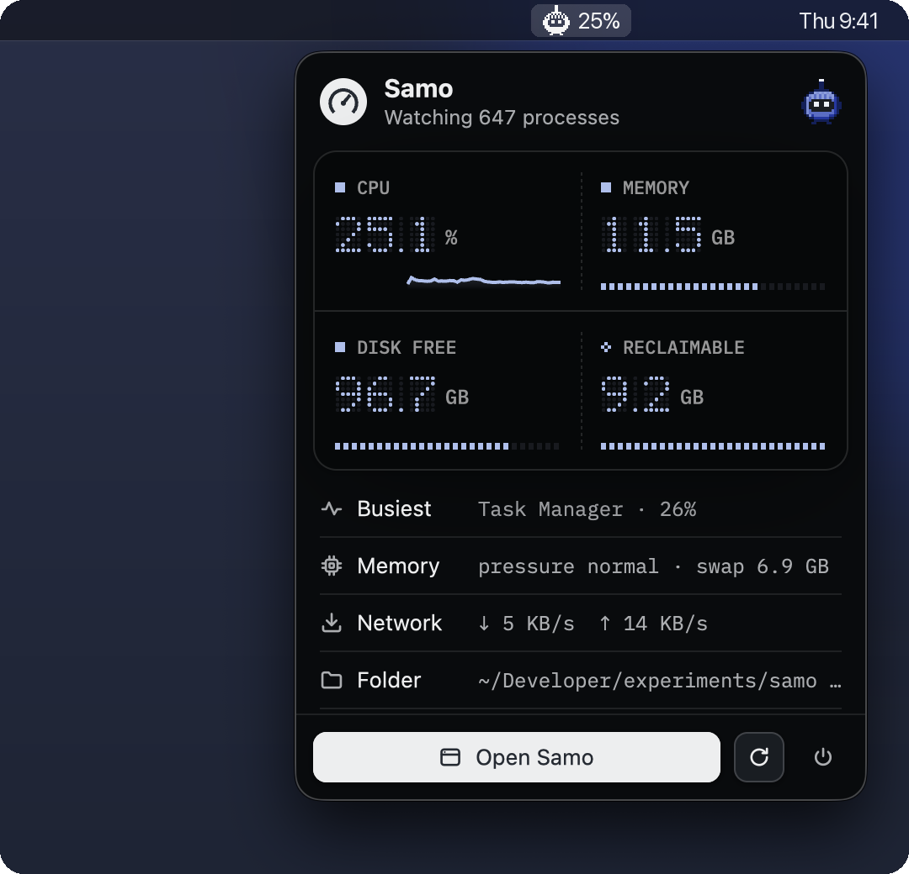

<div align="center">



# Samo

**Where did my disk go, and what is my Mac doing right now?**<br>
A native macOS instrument for both questions, built in Rust with GPUI.

[](#install)
[](rust-toolchain.toml)
[](https://github.com/zed-industries/zed/tree/main/crates/gpui)
[](LICENSE)

<br>



</div>

## What it is

Samo measures a folder, shows you where the space went, and finds the build output you forgot about —
`target`, `node_modules`, `.venv`, `.next`, `dist` — while keeping an eye on CPU, memory, network, disk and heat.
It's a real Mac app: drawn on the GPU by [GPUI](https://github.com/zed-industries/zed/tree/main/crates/gpui) (the
framework behind Zed), no Electron, no web view, about 4 % of one core when idle.

**Samo measures; you decide.** It never deletes anything on its own. What it *suggests* is drawn in dither, what
is measured is solid, and anything you remove goes to the Trash, with Undo.

## Highlights

- **Live, at a glance.** A dark readout strip on every page: CPU, memory, free disk, and what you could reclaim.
- **Overview that's worth watching.** CPU and memory over 2 minutes, 10 minutes or an hour; the busiest processes;
  network, disk activity, memory pressure and macOS's own thermal state. Point at a chart for the exact values.
- **Space you can walk into.** A circle map of the folder, coloured by kind of file. Click a circle to go inside,
  *Up* to come back; recent folders open instantly.
- **Build junk, found.** Every project under the folder, ranked by what Samo could clear, with the artifacts named.
- **Processes.** A fast, virtualised table you can sort; rows hold still under the pointer so a row can't move
  under a click.
- **In the menu bar.** Samo's probe shows the CPU load beside it; click it for a quick panel without opening the
  app. Close the window and Samo keeps running there.
- **Honest readings.** A sensor that stopped leaves a gap in the chart, never a made-up line. Unknown is `--`, not `0`.
- **Light and dark**, and at home in any window from 640 px wide to full screen.

<table>
  <tr>
    <td width="50%"></td>
    <td width="50%"></td>
  </tr>
  <tr>
    <td align="center"><sub><b>Overview</b>, light</sub></td>
    <td align="center"><sub><b>Projects</b> — what each project's build output costs you</sub></td>
  </tr>
</table>

### In the menu bar

<table>
  <tr>
    <td width="50%"></td>
    <td>
      <p><b>The probe is the status.</b> Samo sits in the menu bar with the CPU load beside it, and its eyes are
      the real state: dots when idle, a sweeping bar while it measures, an X when a scan failed.</p>
      <p><b>One click for the quick panel.</b> The same readout as the app, the busiest process, memory
      pressure, the network and the folder being watched. Click a figure to open that page; click anywhere
      else to close it.</p>
      <p><b>Always there.</b> Close the window and Samo keeps running up here; <b>Open Samo</b> or
      <b>⌘0</b> brings it back.</p>
    </td>
  </tr>
</table>

## Install

You need macOS 11 or later, the Xcode Command Line Tools (`xcode-select --install`) and
[rustup](https://rustup.rs). The Rust toolchain is pinned in `rust-toolchain.toml`, so rustup fetches the right one.

```sh
git clone https://github.com/KJ-AIML/samo.git
cd samo
scripts/bundle-macos.sh --install
```

That builds a release, assembles `Samo.app` with its icon, signs it ad hoc (no Apple developer account needed),
copies it to `/Applications` and opens it. Without `--install` the app is left in `target/Samo.app`.

To run it straight from the source instead: `cargo run --release -p samo-gpui`.

> Samo is tested on Apple Silicon. Intel Macs should build from source too, but haven't been tried.

## Using Samo

| Page | What it answers |
| --- | --- |
| **Overview** | How the Mac is doing right now, and where this folder's space went |
| **Projects** | Which projects carry the most build output, and what clearing it would give back |
| **Storage** | The folder as a map: click into folders, reveal them in Finder, move them to the Trash |
| **Processes** | Every process by memory, CPU, disk or PID; quit one (Samo checks it's still the same process first) |
| **Performance** | CPU history, each core, memory in detail, disk and network rates |

- **Pick what to measure** from the folder menu in a page's header: your standard folders (Home, Desktop,
  Documents, Downloads, Developer, Applications) and any folder you add with **Choose folder…**. Added folders are
  remembered in `~/Library/Application Support/Samo/locations.txt` and can be removed from the same menu.
- **⌘0** brings the window back, **⌘Q** quits, **Esc** closes a menu or dialog.

A few environment variables, handy for scripts and screenshots:

| Variable | Does |
| --- | --- |
| `SAMO_DEFAULT_SCAN_ROOT` | The folder to measure first (default: `~/Developer` if it exists, else your home folder) |
| `SAMO_START_PAGE` | `overview`, `projects`, `storage`, `processes`, `performance`, `extensions` or `settings` |
| `SAMO_THEME` | `light` or `dark` instead of following the system |

## Safety and privacy

- **Online only when you click.** No account, no telemetry, nothing about you sent anywhere. Samo goes online only
  when you open **Extensions** or **Settings** by a click, or press Refresh, Install, Update or Check now: then it
  fetches its signed catalog, images and packages from GitHub. Never at launch, never in the background. The
  optional web console listens on `127.0.0.1` only.
- **Only what KJ signed.** The store's catalog is signed, and every package, image and Samo update is checked
  against it before it is used.
- **The Trash, never `rm`.** Before moving anything Samo checks it is still the same file (device and inode) it
  measured. Undo puts it back.
- **The right process.** Quit checks the process's PID *and* start time, so a recycled PID never gets the signal.
- **Readings carry their state.** Every sensor value is `Available`, `Unsupported` or `Stopped`, and the UI shows
  which.

## Extensions

Extensions add to what Samo watches, and you choose which to run: without one, Samo is exactly as above. Each
runs as its own small program, so one that misbehaves is stopped without taking Samo down, and Samo draws its
page with its own parts. Turning one off undoes what it changed outside its own folder; turning it back on puts
that back. The design is [ADR-002](docs/decisions/ADR-002-samo-extensions-design.md).

**Claude Sessions** is the first: your Claude Code sessions at a glance, in the spirit of
[Glance](https://github.com/whoisnaisu/glance) by whoisnaisu (none of its code is used; Claude Sessions is built on
Claude Code's documented hooks and status line).

- Each session's state: *working*, *waiting for you* (a permission, a question, a plan to review) or *done*.
  While one waits, the menu bar shows it beside the CPU figure (`23% !1`) and a pop-up says so, without taking
  the keyboard.
- Today's tokens, per session and in all, read from Claude Code's transcripts (only today's part).
- Your 5-hour and weekly plan limits, from Claude Code's status line, if you turn Plan limits on.
- **Connect** adds Samo's hooks to `~/.claude/settings.json`, after backing it up to `settings.json.samo-bak`;
  **Plan limits** sets Claude Code's status line, never replacing one you have. Both come out exactly when you
  turn them off. It never goes online.

### The store

Open **All extensions** in the sidebar: every extension in Samo's store, and every one you have installed, with
**All · Installed · Updates** and a search box. An extension's page shows its screenshots, what it does and
*what it changes on your Mac*, with **Install**, **Update** or **Uninstall**. Uninstalling first undoes what it
changed, then deletes it (Claude Sessions keeps its one-time backup, `~/.claude/settings.json.samo-bak`). The
store's listings live in [`samo-extensions`](https://github.com/KJ-AIML/samo-extensions): a teammate adds one with
a pull request, and KJ reviews and signs it. The design is [ADR-003](docs/decisions/ADR-003-samo-extension-store.md).

### Developing an extension

Build it into a folder and point Samo at it; it shows as *dev*, and never replaces a store install:

```sh
scripts/ext-dev.sh extensions/claude-sessions     # build it and lay it out in target/ext-dev/
SAMO_EXT_DEV_DIR="$PWD/target/ext-dev" cargo run --release -p samo-gpui
```

`extensions/hello` is a small example extension that uses every part a page can have.

## Updates

**Settings → Updates** says which Samo you have and, when you open it, checks the store for a newer one. **Install
and restart** downloads it, checks it (its signature in the catalog, then the app's id, version and code
signature) before anything changes, then replaces Samo and opens the new one. The old app goes to the Trash, and if
the swap fails it is put back. Samo 0.1.x has no updater: install 0.2.0 from its DMG once.

## Also in the box

- **`samo-cli`** — the same measurements in a terminal:
  `cargo run -p samo-cli -- scan ~/Developer` (file types, projects and what they could give back, largest
  folders) and `cargo run -p samo-cli -- top`.
- **`samo-server` + `ui/`** — a local web console (React and Vite) at `http://127.0.0.1:7420`:
  `npm --prefix ui install && npm --prefix ui run build && cargo run -p samo-server`.

## How it's built

A Rust workspace in strict layers; `cargo run -p xtask -- verify` enforces the order, keeps the pure crates
pure, and runs the tests.

| Layer | Crate | Holds |
| --- | --- | --- |
| L0 | `samo-primitives` | Shared types; `Reading<T>` |
| L1 | `samo-blueprint` | Limits and configuration |
| L2 | `samo-domain` | Pure rules: file classification, project bloat, circle packing, telemetry gaps |
| L3 | `samo-store` | SQLite (WAL), the only database user |
| L4 | `samo-engine` | Commands, access policy, audit log |
| L5 | `samo-macos` | The filesystem scanner, the Trash mover, telemetry and process collection |
| L1 | `samo-ext-protocol` | What Samo and an extension agree on: the manifest, messages and widgets |
| L5 | `samo-extensions` | Extensions on disk, the supervisor that runs their helpers, and the store: its HTTP client (only on a click), signed catalog, cache, installs and Samo's own update |
| extensions | `claude-sessions`, `hello` | The Claude Sessions helper (`samo-claude`) and the example |
| apps | `samo-gpui`, `samo-cli`, `samo-server` | The Mac app, the CLI, the local web server |

The workspace forbids `unsafe` and denies `unwrap`, `expect` and `panic!`. In the Mac app, sensors are read on
their own thread and scans run on theirs, so the UI thread only draws. Samo's look — the ring, the readout, the
probe, the dither — is written down in [`apps/samo-gpui/DESIGN.md`](apps/samo-gpui/DESIGN.md).

## Development

```sh
scripts/ci-local.sh              # rustfmt, clippy -D warnings, xtask verify (what CI runs)
cargo run --release -p samo-gpui # the Mac app; use --release, debug builds idle far hotter
python3 scripts/make-icon.py     # redraw the app icon (needs Pillow)
```

## Credits

- [GPUI](https://github.com/zed-industries/zed/tree/main/crates/gpui) by Zed Industries (Apache-2.0).
- [IBM Plex Mono](https://github.com/IBM/plex), bundled under the SIL Open Font License 1.1. Cabinet Grotesk and
  Switzer are used when installed; they aren't bundled.
- [`tray-icon`](https://github.com/tauri-apps/tray-icon) for the menu bar item and
  [`sysinfo`](https://github.com/GuillaumeGomez/sysinfo) for much of the telemetry.
- The instrument-panel discipline is inspired by [TMOG](https://tmog.org/).

## License

[MIT](LICENSE) © 2026 KJ-AIML
